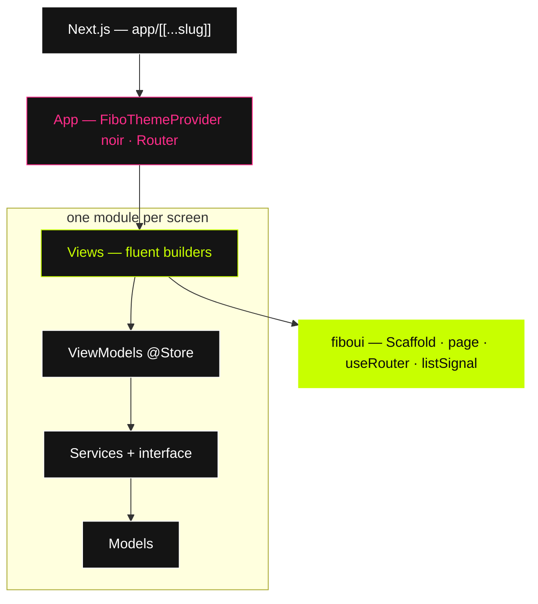

<div align="center">


# FiboUI Boilerplate

**Next.js is the host.** The function return **is** the view.

<br />

[](https://www.npmjs.com/package/fiboui)
[](https://nextjs.org)
[](https://fiboui.vercel.app)

<br />

Official starter for [FiboUI](https://github.com/felipeoliveiradev/fiboui). One catch-all route. Screens, state, and navigation stay on the builders.

</div>

---

## Install

```bash
npm install
npm run dev
```

`postinstall` copies `fiboui/dist/style.css` to `app/fiboui.css`. Import that file. Importing `fiboui/style.css` pulls the package Tailwind config and breaks Turbopack.

The board screen also installs `leaflet`. `leafletEngine()` loads it from inside the published package.

```bash
npm run build
npm run typecheck
```

---

## Screens

<div align="center">

| URL | Module | What you see |
| :---: | :---: | :--- |
| `/` · `/todo` | `todo` | List. `listSignal` filter, add, complete. |
| `/performance` | `performance` | Board. Map, trips, live earnings. |
| `/color` | `color` | Ink sheet. |
| anything else | `status` | 404. Same scaffold, no tab selected. |
| fault · wait | `status` | Error boundary and the loading screen. |

</div>

Every screen is the same chrome: menu at the top left, title, lime **GO**, bottom bar **List · Board · Ink**. GO cycles the three screens. On a status page it goes home.

---

## Architecture



```text
src/modules/<screen>/
├── Models/
├── Services/          interface + implementation
├── ViewModels/        @Store
└── Views/
    └── components/
```

Pages call `getStore()` and `.observer()`. A list is a `listSignal`. No `useState`. No `useEffect`. No `window`, no DOM APIs. Do not use `next/navigation`.

```ts
const router = useRouter()
router.navigate('/performance')
```

Skip `.build()` on a page that is already a builder. `FaultPage` calls `.build()` because the error boundary clones `error` and `onReset` onto a component.

---

## A view

```tsx
Row()
  .width('100%')
  .alignY('center')
  .gap(12)
  .when(When.hover, (row) => row.bg(lime).color('#000'))
  .children([
    Checkbox().checked(todo.isCompleted).controlled(true),
    Text(todo.text).fontSize(16).fontWeight('600'),
  ])
```

The map is a builder too: `MapView().engine(leafletEngine())` in `performance/Views/components/boardMap.ts`. It is not a React component.

---

<div align="center">

| Token | Hex | |
| :---: | :---: | :--- |
| **Ink** | `#000000` | background |
| **Chalk** | `#ffffff` | type |
| **Muted** | `#9a9a9a` | idle |
| **Pink** | `#ff2d8a` | energy |
| **Lime** | `#c8ff00` | mark / GO |

<br />


<br /><br />

**Wear the return.**

[FiboUI](https://github.com/felipeoliveiradev/fiboui) · [Site](https://fiboui.vercel.app) · [npm](https://www.npmjs.com/package/fiboui)

</div>
